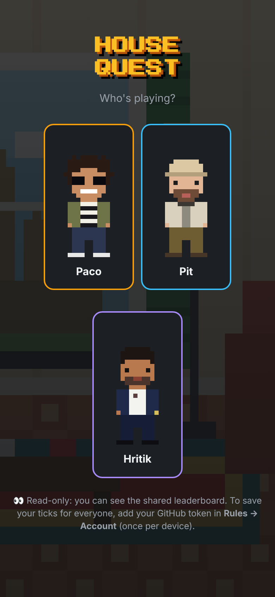
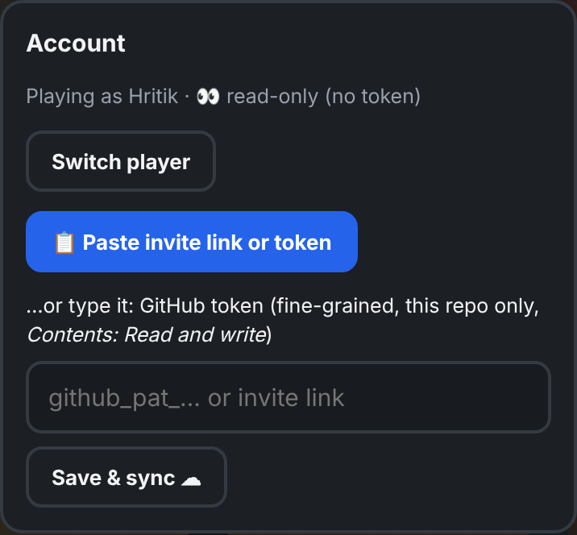
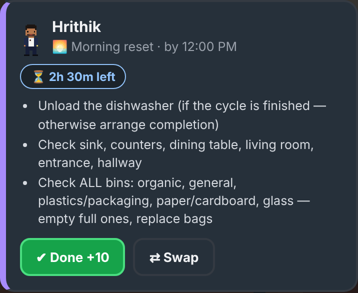
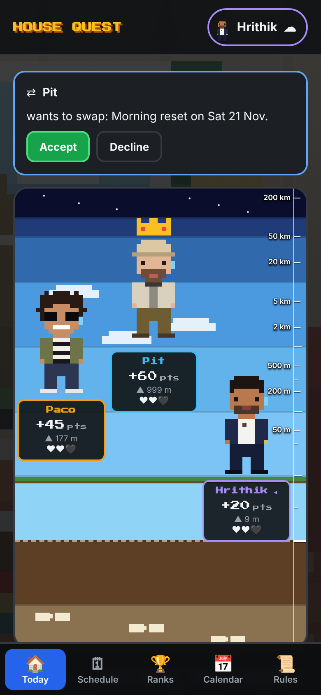
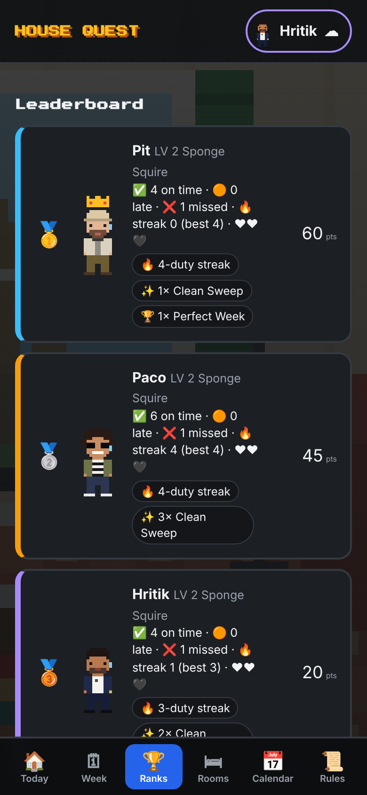
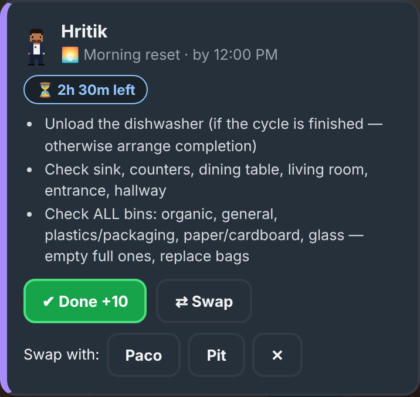
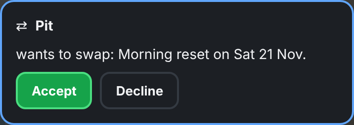
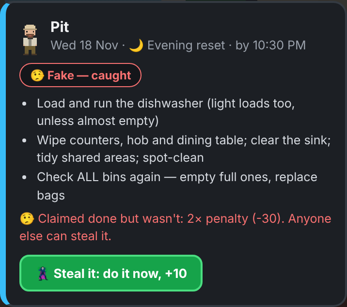
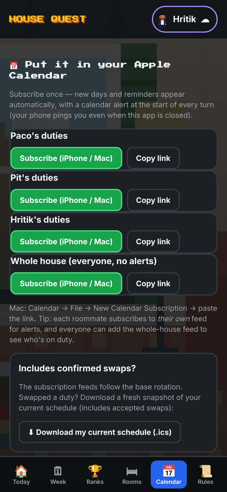
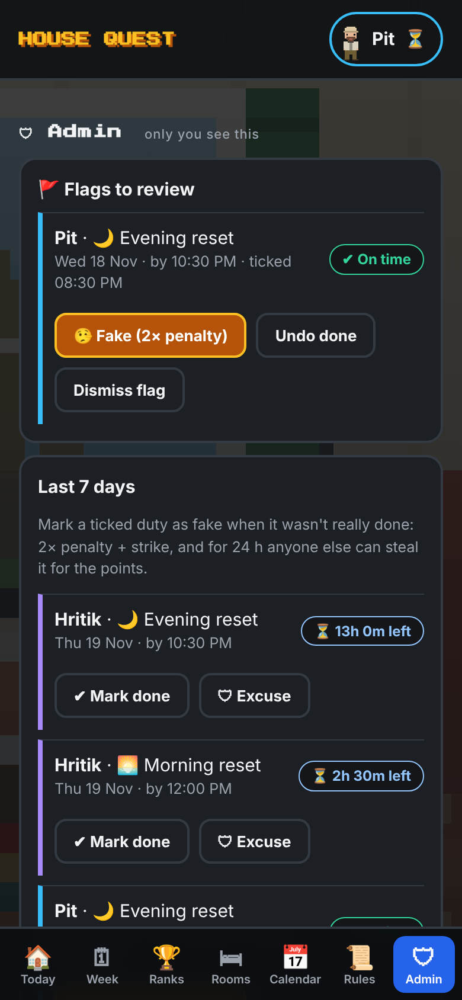

# 🏠 House Quest: how to play

House Quest turns our chores into a game. Do your duties on time and you climb toward the sky. Miss them and you sink toward the magma. It takes about 2 minutes to set up.

**App:** https://pitsieben.github.io/House-keeping-Schedule-/

---

## 1. Set it up (once)

**a) Put it on your Home Screen.** Open the link in **Safari**, then tap **Share → Add to Home Screen**. From now on, open it from that icon.

**b) Pick your name.** The app remembers you on this phone.

**c) Turn on sync.** Pit sends you an **invite link** in a private message.
1. Copy the link (long-press → Copy).
2. Open the app from your Home Screen and go to **Rules → Account**.
3. Tap **📋 Paste invite link or token**.

The cloud ☁ next to your name at the top means you're synced. If you see 👀, the token is missing, so do step c again.

> The Home Screen app and Safari keep separate storage, so do step c **inside the Home Screen app**.

---

## 2. Every day: tick your duty

The **Today** tab shows today's House Captain, the laundry priority and your duties. When you've done your duty, tap **✔ Done**. That's it.

- 🌅 **Morning reset**, by 12:00: dishwasher out, check counters, empty full bins.
- 🌙 **Evening reset**, by 22:30: dishwasher on, wipe surfaces, bins again.
- 🧹 **Weekly cleaning**, Sunday by 20:00: kitchen, living room or terrace. This rotates every week.

Ticked something by mistake? Tap **Undo**.

---

## 3. The leaderboard: heaven or hell?

Everyone starts **on earth (0 points)**. Points push you **up** through the clouds, into space, all the way to the Moon. Penalties drag you **down** past dinosaur bones and through the mantle into the magma. The further apart we are, the more the view zooms out.

| What happened | Points |
|---|---|
| Morning / evening reset on time | **+10** |
| Weekly cleaning on time | **+30** |
| Both resets on the same day (Clean Sweep) | **+5** bonus |
| Every duty of the week on time (Perfect Week) | **+25** bonus |
| Missed a reset | **−15** + strike |
| Missed the weekly cleaning | **−30** + strike |
| Done, but late | half penalty + strike |
| ❗ Ticked as done but **didn't actually do it** (caught) | **double penalty** (−30 / −60) + strike |
| 🦹 Stole a faked duty (did it yourself) | **+ its points** |

The ❤❤❤ under your name are your strikes. **3 strikes in 30 days** means a household review.

The **Ranks** tab has the details: streaks, badges and levels.

---

## 4. Can't do it? Swap

Tap **⇄ Swap** on your duty and choose who you'd like to swap with.

The other person sees a request and taps **Accept** or **Decline**.

⚠ A swap only counts once it's **accepted before the deadline**. A message alone doesn't count.

For genuine emergencies, another roommate can tap **🛡 Excuse**. That means no penalty and no strike.

---

## 5. Honesty rule: faking and stealing

If someone ticks a duty they **didn't actually do**:

1. Anyone can tap **🚩 Not really done?** on that duty, and the admin (Pit) checks.
2. If it was fake, the admin marks it **🤥 Fake**. The faker gets a **double penalty** + a strike.
3. For the next **24 hours**, anyone else can **🦹 steal** it: do the job yourself, tap the button and take the points. It appears under **Up for grabs** on the Today tab.

Simply forgetting a duty only gives the normal penalty. **Only lying about it is punished double.**

---

## 6. Your room: collectibles, outfits and dirt

The **🛏 Rooms** tab shows everyone's pixel bedroom.

- **Monthly achievements** (🌅 Early Bird, ✨ Clean Sweeper, 🔥 On Fire, 🦹 Opportunist, 🤝 Team Player, 🧼 Spotless Month, 🐉 Boss Slayer, 👑 Monthly Champion) each unlock a **collectible** for your room. Levelling up unlocks more.
- Tap a collectible to put it on display or into storage. The shelf, wall and floor have limited space.
- The more achievements you collect, the more **outfits** you unlock (Tracksuit, Barça Kit, Hawaiian, Tuxedo, Superhero, Golden Janitor). Your outfit shows everywhere in the app.
- **Below 0 points, your room gets dirty:** unmade bed → clothes on the floor → cobwebs → flies → biohazard 🤢. Get back above 0 and it's clean again.

---

## 7. Messages: speech bubbles

Type in the **Say something to the house…** box under the leaderboard and tap **Send**. Your message pops up as a speech bubble above your character for everyone.

- The bubble stays until **you** close it with ✕. Closing it only hides it for you; the others still see it until they close it too.
- When several people have written, the bubbles merge into one, with a coloured line pointing to each sender and the time each message was sent ("3 min ago", "18:30"). **✕ close all** clears them in one go.
- A red number on the **Today** tab shows how many messages from the others you haven't closed yet.
- With notifications enabled (Calendar tab → **Enable notifications**), your phone shows new messages while the app is open or recently in the background. A phone can't get them when the app is fully closed. Messages are kept for 14 days.

---

## 8. Get reminders: Calendar

Go to the **Calendar** tab and tap **Subscribe** on **your own** feed. Every turn then appears in your iPhone calendar with an alert, even when the app is closed.

---

## 9. Admin (Pit only)

Pit has a PIN-locked **🛡 Admin** tab for reviewing flags and correcting ticks: mark fake, undo, mark done, excuse. Every admin change shows up in the **Activity** feed on the Today tab, so everyone can see what was changed.

---

**Questions or ideas?** Tell Pit. The goal is a clean home, not fines. 🧽
